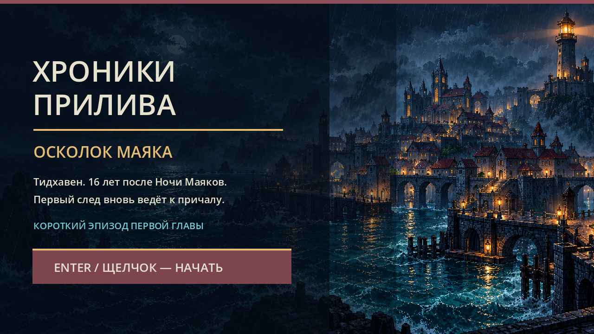
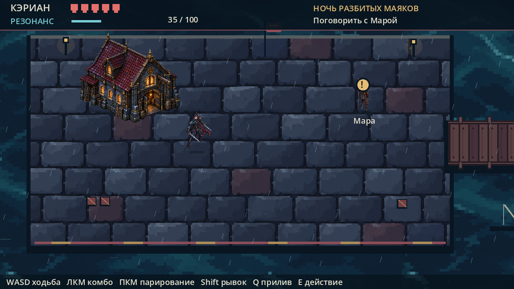
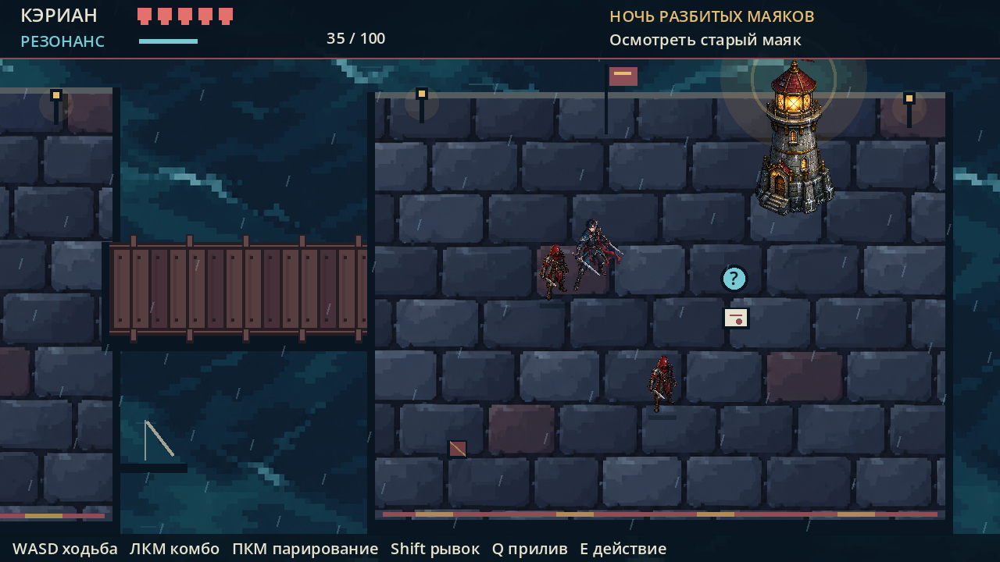

# Хроники Прилива: Осколок маяка

Первая играбельная версия по авторскому дизайн-документу. Это короткий эпизод первой главы, действие которого происходит на причалах Тидхавена. Кэриан получает поручение у стража, пробивается к старому маяку, находит улику и возвращается. Остальные главы и персонажи пока не затронуты.







## Как запустить на другом компьютере

1. Скачайте Godot 4.7.2 Standard (версия без .NET) на свой игровой компьютер. Его достаточно распаковать и запустить: установка не требуется.
2. Перенесите **всю папку `Tide_Chronicles`** через Git или обычным копированием.
3. В Godot нажмите **Import**, укажите `Tide_Chronicles/project.godot`, затем **Run Project** (F5).

На компьютере, где проект создавался, установка Godot не требуется. Для игры после переноса нужен Godot. Готовый `.exe` сейчас не включён: экспорт Windows можно сделать на компьютере с Godot и установленными export templates.

## Управление

| Действие | Клавиша |
| --- | --- |
| Движение | WASD или стрелки |
| Прицеливание | Мышь |
| Комбо парными мечами | Левая кнопка мыши |
| Парирование | Правая кнопка мыши |
| Рывок (20 Резонанса) | Shift |
| Приливный удар (40 Резонанса) | Q |
| Взаимодействие / следующий диалог | E |
| Пауза | Esc |

На начальном экране нажмите Enter или щёлкните мышью. После смерти — R для новой попытки.

## Что уже есть

- Исследуемый причал, два узких тёмных деревянных моста и остров старого маяка.
- Управляемый Кэриан, направление атаки мышью, трёхударное комбо.
- Выносливость в виде Резонанса: атаки и парирование восстанавливают запас, рывок и особый удар расходуют.
- Четыре врага с приближением, предупреждением об ударе и получением урона.
- Короткое задание с разговором, находкой и завершением.
- Экран паузы, поражения и завершения эпизода.
- Авторская панорама Тидхавена, крупнопиксельные фактуры камня и моря, изображения персонажей и маяка. Ночное освещение, дождь, движущаяся вода, анимация ожидания персонажей и деревянные настилы мостов сделаны кодом.
- Звуки ударов, парирования, рывка и диалогов из набора Kenney RPG Audio (CC0; лицензия в `assets/audio/LICENSE.txt`).

## Где развивать проект

Сейчас это законченный небольшой концепт, основа для дальнейших итераций. Весь игровой цикл находится в `scripts/game.gd`. Секции кода разделены комментариями: состояния игры, управление, бой, задания, отрисовка мира, интерфейс. Константы мира и параметры боя вынесены в начало файла. Художественные файлы находятся в `assets/art/`, сведения о создании — в `assets/art/PROMPTS.md`.

Текущие персонажи — статичные изображения с программным дыханием, покачиванием и эффектами ударов; покадровой анимации, музыкальной темы и сохранений пока нет. Визуальное направление стало сдержаннее и крупнопиксельнее по вашему ориентиру на Kingdom Two Crowns, но его графика и ассеты не используются. Следующим крупным шагом могут стать полноценные анимации и выделение отдельных сцен героя, врага, мира и интерфейса. После расширения эпизода стоит добавить сохранение и загрузку.

Проверка основного маршрута без графического окна:

```text
godot --headless --path <папка Tide_Chronicles> --script res://tests/smoke.gd
```

Исходный документ концепции находится вне этого Git-репозитория и не изменён. Эта версия не раскрывает и не фиксирует будущий сюжет.
